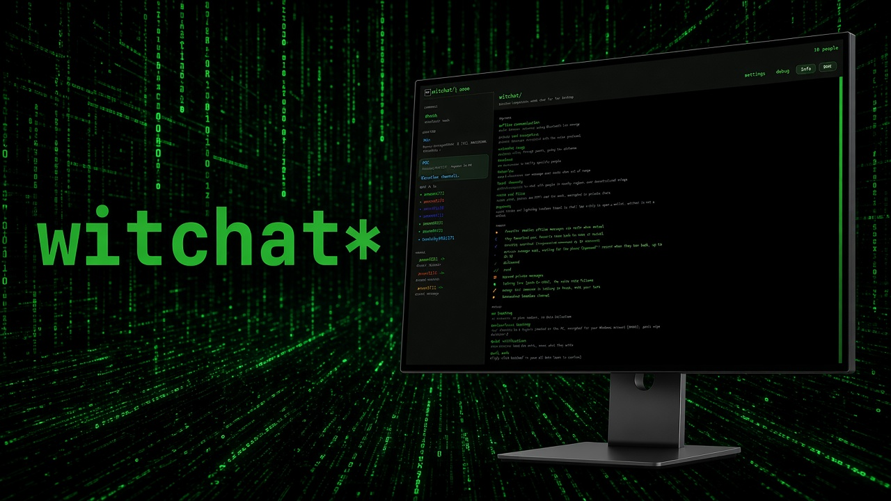
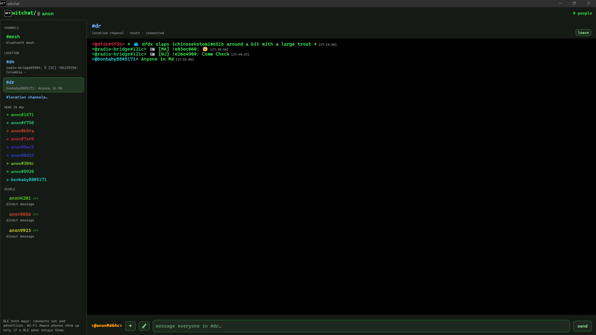
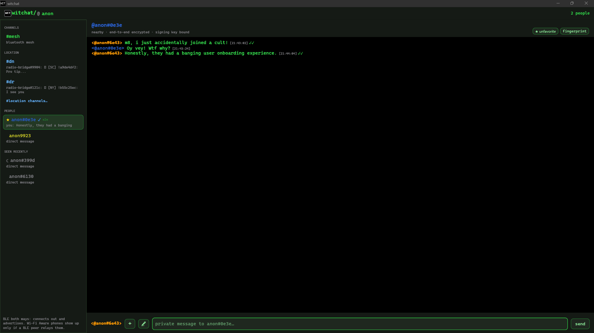
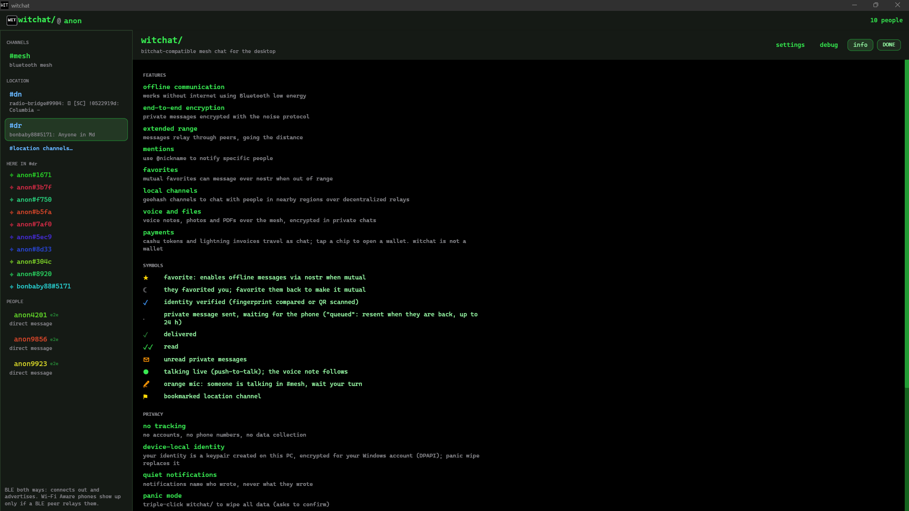

<p align="center"></p>

<h1 align="center">witchat</h1>

<p align="center"><sub>\ˈwit-ˌchat\</sub></p>

<p align="center"><sub>an unofficial bitchat app for windows and linux</sub></p>

<p></p>

<p align="center"><b>Your computer joins the same nearby chat the phones are already in.</b><br>
No account, no phone number, no install, and no server you sign up for. Independent of the official apps.</p>

<p align="center"></p>

<table align="center">
  <tr>
    <td align="center" width="250">
      <a href="docs/witchat_screenshot1.png"></a><br>
      <sub>Location channel</sub>
    </td>
    <td align="center" width="250">
      <a href="docs/witchat_screenshot2.png"></a><br>
      <sub>Private chat</sub>
    </td>
    <td align="center" width="250">
      <a href="docs/witchat_screenshot3.png"></a><br>
      <sub>Info</sub>
    </td>
  </tr>
</table>

People nearby talk on [bitchat](https://github.com/permissionlesstech/bitchat) over Bluetooth. There is no account and no phone number, and nobody has to run a server for the chat to work. A message can hop through other phones, so two people who are too far apart for a direct link can still share one conversation when something in the middle passes it on. The official apps run on iPhone, Mac, and [Android](https://github.com/permissionlesstech/bitchat-android). Witchat 🧙‍♀️ is how a Windows or Linux computer joins them.

**Chat from the computer.** This is the client: you, at the keyboard. Phones running bitchat show up next to you. You type in the shared nearby chat, message someone privately, and send a photo, a voice note, or a file. If you both mark each other as a favorite, those private messages still arrive after you leave Bluetooth range, encrypted the same way the phones already do it.

**Leave the computer on for everyone else.** This is the node: the computer itself, left on in the room. Bluetooth only reaches a short way. A computer left running in between — a desk, a counter, a box you do not turn off — can pass messages along for phones that cannot hear each other. Close the window and it keeps doing that from the tray. A no-window mode is there for a computer nobody sits at. An iPhone and an iPad, out of range of each other, have reached each other this way through a Windows PC in one lab. [Honest limits](#honest-limits) says what is not shown yet.

**If the computers already sitting there did the quiet version of this.** Most Windows and Linux machines have Bluetooth and an internet connection, and they already sit plugged in at homes, offices, shops, and schools. Today a nearby chat only stretches as far as the phones people happen to have open. Headless in the background is the minimum: each computer passes nearby messages along even when the person there never joins the chat. Sitting in the tray is the fuller case: that person can talk too, and the computer keeps passing nearby messages after the window is closed.

Bluetooth is one path. One short step at a time, the nearby chat could then cross a building, a block, or a campus by walking from computer to computer. Two cities stay two nearby chats. Bluetooth has no path between them.

The internet connection is the other path, and each conversation picks one. When two people have both marked each other as favorites, their private messages go through Nostr relays once Bluetooth cannot reach, so that conversation can cross cities. Location channels are rooms on those relays from the start. A line in the nearby chat stays on Bluetooth. Lending the computer's internet connection to the phones around it, so their rooms travel out through the machine, comes after this release.

## Highlights

- 📡 **Real mesh peer:** Bluetooth LE central, plus the peripheral role (Windows, and Linux through BlueZ) when the adapter supports it. Public `#mesh`, relaying, fragments, gossip sync.
- 🔒 **Private messages:** Noise XX end to end, delivered and read receipts. Undelivered messages wait in an encrypted outbox for up to 24 h and are resent when the person is back; meanwhile nearby trusted peers can carry a sealed copy to them, and witchat carries theirs.
- ⭐ **Favorites over the internet:** mutual favorites keep chatting over Nostr, gift-wrapped like iOS.
- 📍 **Location channels:** block-to-region geohash channels, people lists, teleport, and private messages to people there.
- 📎 **Files and voice:** photos, voice notes and PDFs, encrypted in private chats. Nothing auto-plays.
- 🧅 **Opt-in Tor** for every relay connection, fail-closed.
- 🖥️ **Desktop comforts:** keeps running in the tray, notifications that never show message text, slash commands with completion.
- 🛡️ **Safety:** QR and fingerprint verification, `/block`, triple-click panic wipe.
- 📦 **Unzip and run:** no setup program. Your identity stays in your user account, so replacing the folder keeps your keys.
- 🔐 **Trustworthy builds:** SHA-256, a provenance JSON and third-party notices beside the program. MIT licensed.
- ⚠️ **First start on Windows:** the browser and SmartScreen say the publisher is unknown. That is expected for this unsigned build. Check the hash, then continue. Do not turn Defender off.

## 📥 Download

Get `witchat-<version>-windows-x86_64.zip` or `witchat-<version>-linux-x86_64.tar.gz` from [Releases](../../releases). Unzip the folder and run the program inside it. This release has no setup program: nothing is written to Program Files, and there is no uninstall entry. Put the folder in Downloads, on the desktop, or on a USB stick. Delete the folder when you want the program gone.

Your keys, favorites, and settings stay with your user account, so a newer zip does not reset them and a copy of the folder does not carry them to another computer. On Windows that is `%APPDATA%\witchat`. On Linux it is `~/.local/share/witchat`. Logs sit beside that data. **Panic wipe** clears it. **Start at login** is off until you turn it on; that setting is what adds a startup entry. More on the keys: [Honest limits](#honest-limits).

The Windows exe is unsigned. Each archive carries a `.sha256`, a provenance `.json` (git commit, compiler, build time) and `THIRD-PARTY-NOTICES.txt`. What changed and what is known not to work yet: [CHANGELOG.md](CHANGELOG.md).

### ⚠️ First run: the warnings

Windows will warn you before witchat opens. This build has no publisher signature, so the browser, SmartScreen, and sometimes Defender all say the file is unknown. Those warnings are expected. They are not a report that this file is a known virus. Do not turn Defender off, and do not turn off ransomware protection.

Trust the file when its hash matches this Release, and only then. A match means you have the file the project published. It does not mean Microsoft has reviewed witchat. If the hash differs, delete the download and get it again from the Release page. Do not run a copy that arrived by mail or from another site. Copying the folder to a USB stick can hide the SmartScreen window and still proves nothing; check the hash anyway.

1. The browser may say the zip is uncommon or block it. Keep it only when the download came from this project's Release.
2. Check the zip before you unzip it. In PowerShell, `Get-FileHash .\witchat-<version>-windows-x86_64.zip` matches the Windows line in `SHA256SUMS.txt` on that Release page. Capital letters do not matter.
3. Unzip. In that folder, `Get-FileHash .\witchat.exe` must match `witchat.exe.sha256` sitting next to the program. That file is the hash of the exe. `SHA256SUMS.txt` is the hash of the zip, so the two numbers are different on purpose.
4. In File Explorer, double-click `witchat.exe`. A window may say the publisher could not be verified. After the hash matched, choose **Run**.
5. A blue window titled "Windows protected your PC" is SmartScreen. The publisher line says unknown. Click **More info**, confirm the name is `witchat.exe`, then **Run anyway**. Windows remembers that file, so the next start is quiet.
6. A toast that says "Risky action blocked", or a window that says "Access is denied", usually means the folder is on the Desktop or inside OneDrive. Defender's ransomware rule is blocking an unsigned program from writing there. Open **Windows Security → Protection history**, select that event, and choose **Allow on device**. Then start `witchat.exe` again from File Explorer. If it still will not start, the remaining clicks are in [docs/WINDOWS.md](docs/WINDOWS.md#defender-risky-action-blocked--access-is-denied).

- **Linux:** needs BlueZ. There is no publisher dialog. `tar -xzf witchat-*.tar.gz && sha256sum -c witchat.sha256` prints OK, then `./witchat`. Notes: [docs/LINUX.md](docs/LINUX.md).

## Quick start

1. Open official bitchat on a phone near the PC, Bluetooth on. Keep it open on the screen until the PC finds it: a PC cannot discover an iPhone while bitchat is in the background.
2. Start witchat with Bluetooth on. The phone shows up in the sidebar within seconds; type in `#mesh`.
3. Click a person to message them privately. Star them, and have them star you, to keep chatting over Nostr when you are apart.

Bluetooth off (`HRESULT 0x800710DF`) and other radio trouble: [docs/WINDOWS.md](docs/WINDOWS.md) or [docs/LINUX.md](docs/LINUX.md). Logs rotate under `%LOCALAPPDATA%\witchat\witchat\data\logs` (Windows) or `~/.local/share/witchat/logs` (Linux). Filing a bug? Attach the report from **witchat/ → debug → copy diagnostics report** (or `witchat --diag`); it leaves out messages, keys and names.

## Why this exists

Official bitchat is iOS, macOS, and Android. A PC still cannot join that mesh without a reimplemented protocol stack.

Other desktop work: [BitChat Desktop](https://github.com/youhanasheriff/bitchat-desktop) is a restyled official **Mac** app; its Windows/Linux builds are Bluetooth scan-only. [bitchat-tui](https://github.com/E8EgsqUO/bitchat-tui) is a terminal client. [zakkeasterbrook/bitchat-windows](https://github.com/zakkeasterbrook/bitchat-windows) is a 90-line UDP console.

Witchat is a working Windows/Linux messenger: iced desktop GUI, a folder you unzip and run, and an auditable Rust protocol crate. It follows the official apps rather than leading them: no wire changes of its own, and privacy changes only once both official platforms ship them.

## Features

<details>
<summary>📡 <b>Mesh</b>: packets, relaying, sync, diagnostics</summary>

- Binary packet encode/decode (v1/v2), padding, zlib/deflate, announce TLVs, public messages.
- BLE central: scan the official service UUID, connect, exchange frames. When the adapter supports the peripheral role, witchat also advertises the bitchat service so phones can connect in (WinRT on Windows, BlueZ on Linux).
- Public chat, TTL relay, fragment split/reassembly sized to each link's MTU, packet dedup, and iOS-compatible gossip sync (Golomb-coded set filters) so neighbors fill each other's `#mesh` and peer list without resending what the other already has.
- Reconnects: witchat announces as soon as a link comes up, so a phone walking back into range sees it within seconds.
- `/ping nick` measures the round trip to a mesh peer (`pong from bob: 42 ms · 3 hops`). `/trace nick` estimates the path from the neighbor lists phones put in their announces (`estimated path: you → amy → bob (2 hops)`). Both work as on iOS.
- **witchat/ → debug**, after Android's debug sheet: a live mesh map, Bluetooth links with RSSI and traffic (disconnect any), nearby devices (skip a reconnect backoff), peers with session state and capabilities, packet counters with drop reasons, gossip sync, Nostr relay health, and a verbose-logging switch.
</details>

<details>
<summary>🔒 <b>Private messages</b>: Noise, receipts, outbox, favorites, verification</summary>

- Noise XX: pick a person and type. Witchat handshakes automatically, queues the message until the session is secured, resends until the phone acknowledges it, and shows delivered (✓) and read (✓✓) receipts. Transport uses the official explicit-nonce framing. Messages over the official 255-byte limit go out as several, split on word boundaries.
- **Outbox:** a message that is not acknowledged is kept for up to 24 h (100 per person, 8 delivery rounds, as iOS) and sent again, under the same id, whenever that person's phone is back in range. The line says "queued" until then, or "with couriers" once a nearby peer is carrying a sealed copy. The outbox survives restarts, sealed with DPAPI (Windows) or a Secret Service key (Linux); with no keyring it lasts until you quit. A message sent to an out-of-range favorite over Nostr is kept the same way until they acknowledge it. Receivers drop duplicates by message id, and witchat remembers received ids for 25 h so a resend after a restart is not shown twice.
- **Couriers**, as on iOS: while a mesh message waits, or after every Nostr relay has refused one, witchat seals a copy to the person's key (a one-time prekey from their published bundle when it has one, so a later key leak cannot open it) and hands it to up to three nearby mutual favorites or verified peers, who deliver it if they meet that person first. A relay that already accepted the message does not get a courier copy. Witchat carries mail the same way for others (opaque, 24 h, at most 40 envelopes) and opens mail carried to you. Couriers never see who wrote it or what it says. Details and limits: [SECURITY.md](SECURITY.md).
- Favorites and verification: star someone (sends the official `[FAVORITED]` notice; a moon means they favorited you first), compare fingerprints, mark them verified. After each handshake both sides exchange signed-key state, and witchat warns if it contradicts the announce.
- QR verification, compatible with iOS: settings shows a signed "scan to verify me" code that renews every 4 minutes. To verify a phone, hold its QR up to the webcam, open a screenshot of it, or paste the `bitchat://verify?…` link. Witchat marks it verified only when the phone proves it holds the key in the code. `witchat.exe --qr-lab` runs the swapped-key experiment.
- Over Nostr: mutual favorites exchange their `npub`. When that person is out of Bluetooth range, witchat sends an iOS-compatible gift wrap (kinds 1059/13/14, XChaCha20-Poly1305) through the iOS relays, with receipts. Offline favorites stay in the sidebar.
- Private message history is never written to disk (only the encrypted outbox of unsent messages is).
</details>

<details>
<summary>📍 <b>Location channels</b>: geohash cells, people, location DMs</summary>

- **#location channels…** opens the iOS-style list: after you click **get location and my geohashes** once, it shows your block, neighborhood, city, province and region cells with `[N people]`. The position (Windows location, or GeoClue on Linux) is used only as geohashes, kept in memory, never stored; once you have allowed it, witchat takes a fresh fix at each launch so phones keep counting you. **remove location access** turns it off.
- With a channel open, **HERE IN #cell** lists who was heard in the last 5 minutes. Click a name to message them privately; the message is gift-wrapped between your key for that cell and theirs, so it is not linked to your mesh identity. A phone round trip for these messages is not in the lab log yet.
- **quick join** suggests your region's channel, bookmarks (⚐/⚑) are kept, **teleport** joins any geohash (`/geo 9q8yy` works too). Posts to a cell you are not in carry the `teleport` tag, as on iOS.
- Each channel uses the 5 relays closest to the cell from the same directory iOS uses, refreshed daily from bitchat's GitHub list and validated by the iOS rules.
- With **route relays through tor** on, relay traffic goes through a Tor already running on this PC, and witchat sends presence like the phones. Otherwise relays see your IP address, and the sheet says so.
</details>

<details>
<summary>📎 <b>Files, voice, payments</b></summary>

- Incoming images, voice notes and PDFs (signed broadcast, or encrypted in a private chat) are validated (MIME allow-list, magic bytes, 1 MiB cap), saved to `Downloads\witchat` and shown inline. Voice notes play inside witchat. **Nothing auto-plays.**
- The 🎤 button records a voice note (up to 30 s, Windows). Send files with **+**, drag-and-drop, or `/send <path>`. Witchat advertises the iOS private-media capabilities, so phones send encrypted, and missed private files are resent when the phone reconnects.
- Live push-to-talk from a phone shows "talking live"; the finished note arrives as usual.
- `/pay <cashu-token>` sends a Cashu token as iOS does (public chats need `/pay <token> public`). Cashu tokens and Lightning invoices become chips that open your wallet. Witchat is a carrier, not a wallet.
</details>

<details>
<summary>🖥️ <b>Desktop app</b>: tray, notifications, UI, safety</summary>

- **Keeps running in the tray:** closing the window leaves witchat relaying and receiving; the tray icon reopens it or quits. Settings > NOTIFICATIONS turns this off. Linux needs a notification-area host (GNOME/KDE panel). **Stay awake while relaying** (off by default) holds off idle sleep on mains power.
- **Headless relay:** `witchat --relay` runs a separate relay node with no window, for a PC or Linux box left on ([Linux](docs/LINUX.md#headless-relay), [Windows](docs/WINDOWS.md#headless-relay)). **witchat/ → debug → what this PC does for the mesh** shows what any instance relays, as counts only.
- **Notifications:** a toast for private messages and @mentions while witchat is in the background; clicking it opens the chat. Toasts name who wrote and where, never the message, because they can show on the lock screen. The panic wipe clears them from the notification history.
- BitChat-style UI: `witchat/ @nick` header with inline nickname editor, IRC-style `<@nick> text [HH:MM:SS]` rows with per-peer colors, unread envelope, taskbar flash, "seen recently" peers, `#geohash` tags and links you can click.
- `/` shows matching commands; Up/Down picks, Tab or Enter completes. Settings and info open from the `witchat/` title.
- Safety: `/block` hides a person and keeps their files off disk. `/clear` empties a chat. Triple-click the title (or **panic wipe** in settings) to wipe identity, favorites, bookmarks, history, the outbox, mail you are carrying, and the list of peers this PC has met, after one confirmation.
- Optional saved history: `/history on` keeps `#mesh` and location lines as plaintext JSON (newest 2,000 per channel). Off by default; `/history off` and the panic wipe delete it.
</details>

## Honest limits

- **Mostly central-only radio.** Official phones are central+peripheral. On Windows, witchat also advertises when the adapter supports it; phones connect in and chat. Relaying between two phones through the PC has been shown once in a lab (an iPhone and an iPad out of each other's range, 2-hop ping), not yet with Android. Linux advertises through BlueZ, but no phone has connected to it in a lab yet. Phones that only see you over **Wi-Fi Aware** will not appear until they advertise Bluetooth.
- **Needs a phone.** The mesh cannot be proven without official bitchat nearby. BitChat Desktop's Windows/Linux previews do not speak GATT, so they are not test peers.
- **Runs while open.** Closing the window leaves witchat in the tray (Windows, and Linux when the desktop has a notification area). Settings > **start at login** (off by default) starts it hidden in the tray. Quit from the tray icon.
- **Not a wallet.** `/pay` and payment chips are a carrier, like official bitchat.
- **Tor is opt-in and not bundled.** Settings > TOR routes relays through Tor Browser (`127.0.0.1:9150`) or the tor service (`127.0.0.1:9050`). Without it, location channels and Nostr messages reach relays from this PC's IP ([Windows](docs/WINDOWS.md#tor-opt-in), [Linux](docs/LINUX.md#tor-opt-in)).
- **Keys on disk.** On Windows, identity, the outbox, and the public keys of peers this PC has met are encrypted with DPAPI for your account. On Linux they are wrapped with a session keyring (Secret Service) key when one is available; otherwise the identity is an owner-only file and the outbox and peer list stay in memory. Details: [SECURITY.md](SECURITY.md).
- **iced GUI, not Win32/GTK,** and **not a Mac client** (official bitchat covers macOS).
- **Do not install official Android from this repo.** Use Play Store or their reproducible releases.

## Build

Requires Rust 1.90+ and, on Windows, [MSVC Build Tools](https://visualstudio.microsoft.com/visual-cpp-build-tools/) (Desktop development with C++).

```
cargo test --workspace
cargo build -p witchat-app --release
```

Release binary: `target/release/witchat.exe` (Windows) or `target/release/witchat` (Linux). Packaging writes the same unzip-and-run folder as the Releases page: `powershell -File scripts/build-windows.ps1` or `bash scripts/build-linux.sh`. If PowerShell says `cargo` is not recognized, run `. .\scripts\use-rust.ps1` first.

Command-line flags:

```
cargo run -p witchat-app -- --scan            # terminal mesh client instead of the GUI
cargo run -p witchat-app -- --relay           # headless relay node, own identity (docs/LINUX.md, docs/WINDOWS.md)
cargo run -p witchat-app -- --testnet         # official Debug phone builds (UUID …4B5A)
cargo run -p witchat-app -- --no-advertise    # connect out to phones only; do not publish the GATT service
cargo run -p witchat-app -- --geohash 9q8yy   # terminal location-channel client
cargo run -p witchat-app -- --geo-lab dn      # why a phone does or doesn't list witchat in a cell
cargo run -p witchat-app -- --qr-lab mine     # swapped-key QR experiments
```

## Commands

| Input | Effect |
|---|---|
| text | send to the open conversation (`#mesh`, a private chat, or a location channel) |
| `/msg nick text` | private message from anywhere (handshakes automatically) |
| `/nick name` | change nickname and re-announce (default `anon` + 4 digits, as on the phones) |
| `/fav nick` / `/unfav nick` | favorite or unfavorite someone and tell them |
| `/hug nick` / `/slap nick` | iOS emotes |
| `/ping nick` / `/trace nick` | round-trip time / estimated mesh path to a mesh peer (`#mesh` and mesh private chats) |
| `/geo <cell>` / `/leave` | join a location channel / leave the open one |
| `/send <path>` | send an image, voice note or PDF (max 1 MiB) |
| `/sendvisible <path>` | private chat with a peer lacking encrypted media: send signed but readable |
| `/pay <token>` | send a Cashu token (`/pay <token> public` in public chats) |
| `/block [nick]` / `/unblock [nick]` | hide or unhide someone |
| `/clear` | empty the open conversation |
| `/history [on\|off]` | saved `#mesh`/location history (off by default) |
| `/who` | re-announce |
| `/help` | list commands |
| `/hs nick` | force a fresh Noise handshake (troubleshooting) |

## Security and contributing

How witchat protects you, what it does not protect, what it keeps on disk, and how to report a vulnerability: [SECURITY.md](SECURITY.md). Building, checks, project rules and phone test cases: [CONTRIBUTING.md](CONTRIBUTING.md).

## License

MIT. The protocol is reimplemented from the official iOS/macOS sources, which are released under the **Unlicense**. Official Android is **GPL-3.0**; it was used only as a read-only reference and never copied.
